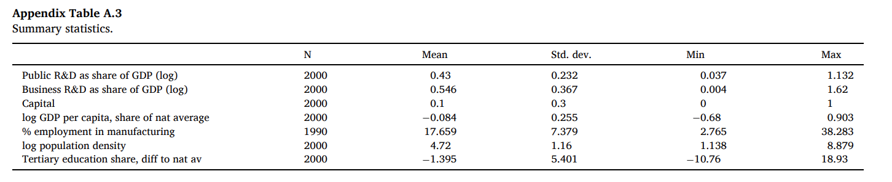
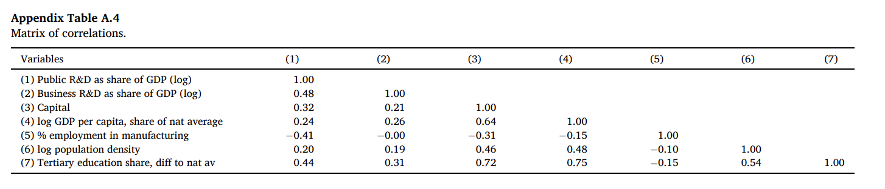

```{r}
library(tidyverse)
library(modelr)
library(flextable)
library(plm)
library(vtable)
library(rstatix)
library(modelsummary)

options(paged.print = FALSE)
```

```{r}
load(file = 'eu0823.RData', verbose = TRUE)
```

# 1) Sammendrag

Fitjar (2025) (KILDE!!!) undersøker hvordan offentlige midler til forskning og utvikling (FoU) fordeles mallom europeiske regioner, og om fordelingen bidrar til å opprettholde eller forsterke regionale forskjeller. Studien bruker data fra Eurostat for 200 europeiske regioner i perioden 2009-2018 og sammenligner utviklingen i offentlig FoU med FoU i næringslivet.

Resultatene viser at mer utviklede regioner mottar mer oppentlige FoU-midler, særlig i sammenheng med høyere humankapital og mer FoU i næringslivet. Studien finner beta-konvergens i offentlig FoU, som betyr at regioner med lave utdanningsnivåer har hatt raskere vekst. Likevel finner den ikke sigma-konvergens, altså en reduksjon i den samlede spredningen mellom regionene. For næingslivets FoU finner studien begge former for konvergens. Fitjar konkluderer med at offentlig FoU-finansiering i stor grad kanaliseres til allerede ressurssterke regioner og dermed kan bidra til å opprettholde eller forsterke regionale forskjeller.

# 2) Systemet med NUTS regioner i EUs regional-data

NUTS står for "Nomenclature of Territorial Units for Statistics" og er EUś system for å dele land inn i geografiske områder til statistiske formål. Systemet brukes av Eurostat for å organisere regional statistikk og gjøre det lettere å sammenligne blant annet økonomi, befoklning og forskningsaktivitet mellom regioner i ulike land. (KILDE EUROSTAT!!!)

Inndelingen er hierarkisk og består av tre nivåer. NUTS 1 omfatter store sosioøkonomiske regioner, NUTS 2 omfatter mindre regioner som er særlig viktige for regionalpolitikk, og NUTS 3 omfatter små regioner for mer dataljerte analyser. En NUTS 1-region deles dermes inn i NUTS 2-regioner, som igjen deles inn i NUTS 3-regioner.

Inndelingen bygger så langt som mulig på eksisterende administrative grenser. Det finnes også veiledende befolkningsgrenser for hvert nivå for å gjøre regionene mer sammenlignbare. NUTS gjør det mulig å undersøke forskjeller innad i land som ellers kan bli skjult når man bare sammenligner nasjonale gjennomsnitt.

# 3) Beskrivende statistikk og korrelasjonsmatrise

## Bskrivende statistikk

```{r}
# Lager logaritmerte variabler
eu0823 <- eu0823 |>
  mutate(
    GDP_log = log(GDP),
    Density_log = log(Density)
  )

# Velger variablene til tabellen
variabler <- eu0823 |>
  select(pub_RD, priv_RD, Capital, GDP_log,
         Manuf, Density_log, edu)

# Beregner beskrivende statistikk
beskrivende <- vtable::st(
  variabler,
  summ = c(
    "notNA(x)",
    "mean(x)",
    "sd(x)",
    "min(x)",
    "quantile(x, probs = 0.25, na.rm = TRUE)",
    "quantile(x, probs = 0.75, na.rm = TRUE)",
    "max(x)"
  ),
  summ.names = c(
    "N", "Mean", "Std. Dev.", "Min",
    "Pctl. 25", "Pctl. 75", "Max"
  ),
  digits = 3,
  out = "return"
)

flextable::flextable(beskrivende) |>
  flextable::theme_booktabs() |>
  flextable::autofit()
```

Beskrivende statistikk Fitjar



### Sammenligning beskrivende statistikk

Vårt datasett har 3136 observasjoner, mens Fitjar (2025) har 2000 for de fleste variablene. Datasettet vårt dekker perioden 2008-2023, mens artikkelens hovedanalyse dekker 2009-2018. Gjennomsnittet for logaritmert BNP er -0,084 i begge tabellene, og utdanningsvariabelen har også et relativt likt gjennomsnitt. Befokningstettheten er noe høyere hoss oss, mens andelen hovedstadsregioner er litt lavere.

Industrivariabelen skiller seg mest ut, med et stanadardavvik på 14,1 hos oss mot 7,379 i artikkelen. Maksimumsverdien på 116 bør undersøkes dersom variabelen måler en prosentandel. FoU-variablene kan ikke sammenlignes direkte, siden artikkelen bruker logaritmerte verdier. Samlet ligner datasettene på flere områder, men forskjeller i periode, utvalg, og variabelbehandling begrenser sammenlignbarheten.

## Korrelasjonsmatrise

```{r}
# Velger perioden og variablene
korrelasjon_alle <- eu0823 |>
  filter(time >= 2008, time <= 2023) |>
  select(pub_RD, priv_RD, Capital, GDP_log,
         Manuf, Density_log, edu) |>
  rstatix::cor_mat() |>
  rstatix::pull_lower_triangle(diag = TRUE)

# Viser korrelasjonsmatrisen som en tabell
flextable::flextable(korrelasjon_alle) |>
  flextable::theme_booktabs() |>
  flextable::autofit()
```

Korrelasjonsmatrise Fitjar



### Sammenligning korrelasjonsmatrise

Korrelasjonsmatrisene viser flere av de samme mønstrene. Sammenhengen mellom hovedstadregion og logaritmert BNP er 0,64 i begge datasettene. Korrelasjon mellom utdanning og BNP er også ganske lik med 0,72 hos oss mot 0,75 i artikkelen. Dette viser at høyere BNP henger sammen med høyere utdanningsnivå i begge datasettene.

Industrivariabelen viser derimot betydelige forskjeller. Korrelasjonen med BNP er 0,22 hos oss, men -0,15 i artikkelen. Også sammenhengene med utdanning og befolkningstetthet har motsatt fortegn. Dette bør ses i sammenheng med de uvanlige industriverdiene i vår beskrivende statistikk. Forskjellene i korrelasjonene kan ha sammenheng med at industrivariabelen har ulik fordeling i de to datasettene, med større spredning og høyere maksimumsverdi i vårt datasett. Offentlig og privat PoU er positivt korrelert i begge datasettene, med 0,41 hos oss mot 0,48 i artikkelen, men ulik logaritmering gjør sammenligningen mindre direkte.
